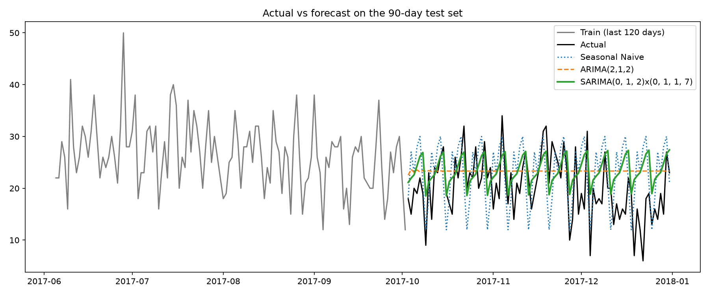

# Demand Forecasting with ARIMA and SARIMA

Forecasting daily retail demand using ARIMA and SARIMA, compared against naive baselines.

## Problem
Predict the next 30 days of sales for one store-item series, and measure how much
a statistical model improves on simple baselines.

## Dataset
Kaggle: Store Item Demand Forecasting Challenge (daily sales, 2013-2017).
Series used: store 1, item 1. Download `train.csv` into `data/`.

## Method
1. Cleaned data, set a daily index, filled gaps
2. Decomposed trend and weekly seasonality
3. Tested stationarity (ADF) and used ACF/PACF to guide model orders
4. Built Naive and Seasonal Naive baselines
5. Fitted ARIMA and a SARIMA grid search (selected by AIC)
6. Evaluated on a 90-day hold-out set (MAE, RMSE)
7. Checked residuals (Ljung-Box test), then forecast the next 30 days

## Results
| Model | MAE | RMSE | MAE improvement vs Seasonal Naive |
|---|---|---|---|
| "SARIMA(0, 1, 2)x(0, 1, 1, 7)"| 4.91 | 6.04 | 24.0%|
| ARIMA(2, 1, 2) | 5.30 | 6.56 | 18.0% |
| Seasonal Naive | 6.46 | 7.76 | 0.0 % |
| Naive | 8.78 | 10.15 | -35.9% |


## How to run
```
pip install -r requirements.txt
python forecasting.py      # or run cell by cell in VS Code
```

## Tools
Python, pandas, NumPy, statsmodels, Matplotlib
